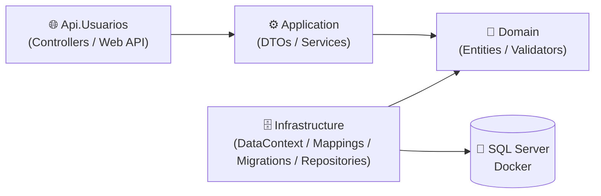
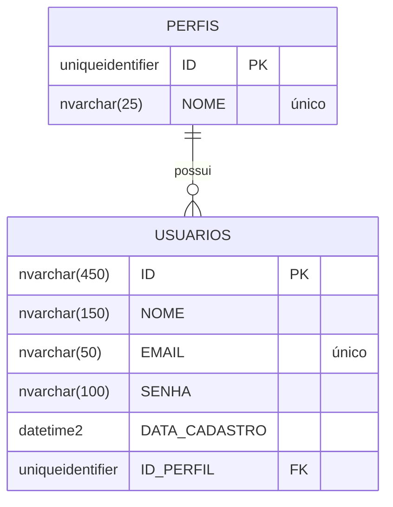

<h1 align="center">👤 Api.Usuarios</h1>

<p align="center">
  API REST para gestão de <b>usuários</b> e <b>perfis de acesso</b>, construída com <b>ASP.NET Core (.NET 10)</b>,
  <b>Entity Framework Core</b> e <b>SQL Server</b> rodando em <b>Docker</b>, organizada em camadas no estilo <b>DDD</b>.
</p>

<p align="center">
  
  
  
  
  
</p>

<p align="center">
  
</p>

---

## 📌 Sobre o projeto

O **Api.Usuarios** é um projeto de estudo desenvolvido durante o curso **C#.NET WebDeveloper (COTI Informática)**.
O objetivo é construir, passo a passo, uma API de cadastro de usuários com controle por perfis, aplicando boas práticas
de arquitetura em camadas, mapeamento objeto-relacional com Entity Framework Core e banco de dados containerizado.

---

## 🧱 Arquitetura

A solução está dividida em quatro projetos, cada um com uma responsabilidade:



| Projeto | Responsabilidade |
|---|---|
| **Api.Usuarios** | Camada de apresentação: configuração da Web API, controllers e OpenAPI |
| **Api.Usuarios.Application** | Casos de uso da aplicação: DTOs e serviços |
| **Api.Usuarios.Domain** | Núcleo do negócio: entidades e validações |
| **Api.Usuarios.Infrastructure** | Acesso a dados: `DataContext`, mapeamentos do EF Core, migrations e repositórios |

### 📂 Estrutura de pastas

```
Api.Usuarios/
├── Api.Usuarios/                    # Web API (ASP.NET Core)
│   ├── Controllers/
│   ├── Properties/launchSettings.json
│   └── Program.cs
├── Api.Usuarios.Application/
│   ├── DTOs/
│   └── Services/
├── Api.Usuarios.Domain/
│   ├── Entities/
│   │   ├── Perfil.cs
│   │   └── Usuario.cs
│   └── Validators/
├── Api.Usuarios.Infrastructure/
│   ├── Contexts/DataContext.cs
│   ├── Mappings/
│   │   ├── PerfilMap.cs
│   │   └── UsuarioMap.cs
│   ├── Migrations/
│   └── Repositories/
├── docker-compose.yml
└── Api.Usuarios.slnx
```

---

## 🗃️ Modelo de dados

Um **Perfil** pode ter vários **Usuários**, e cada **Usuário** pertence a um único **Perfil**.



**Regras definidas no mapeamento (EF Core Fluent API):**

- 🔑 `PERFIS.NOME` é obrigatório e **único** (máx. 25 caracteres)
- 📧 `USUARIOS.EMAIL` é obrigatório e **único** (máx. 50 caracteres)
- 🔗 `USUARIOS.ID_PERFIL` é chave estrangeira para `PERFIS.ID`
- 📅 `DATA_CADASTRO` é preenchida automaticamente no momento da criação

---

## 🛠️ Tecnologias

- **.NET 10** / **ASP.NET Core Web API**
- **Entity Framework Core 10** (SQL Server, Migrations, Fluent API)
- **SQL Server 2022** (imagem oficial da Microsoft)
- **Docker / Docker Compose**
- **OpenAPI** (`Microsoft.AspNetCore.OpenApi`)

---

## 🚀 Como executar

### Pré-requisitos

- [.NET SDK 10](https://dotnet.microsoft.com/download)
- [Docker Desktop](https://www.docker.com/products/docker-desktop/)
- Ferramenta do EF Core:
  ```bash
  dotnet tool install --global dotnet-ef
  ```

### 1️⃣ Clonar o repositório

```bash
git clone https://github.com/sladeghaag-afk/Api.Usuarios.git
cd Api.Usuarios
```

### 2️⃣ Subir o banco de dados

```bash
docker compose up -d
```

O SQL Server ficará disponível em `localhost,1435` (a porta 1433 do container é exposta como **1435** na máquina).

### 3️⃣ Aplicar as migrations

```bash
dotnet ef database update --project Api.Usuarios.Infrastructure
```

Isso cria as tabelas `PERFIS` e `USUARIOS` com seus índices e relacionamento.

### 4️⃣ Rodar a API

```bash
dotnet run --project Api.Usuarios
```

A API sobe em **http://localhost:5236**.
Em ambiente de desenvolvimento, o documento OpenAPI fica em `http://localhost:5236/openapi/v1.json`.

---

## 🗺️ Roadmap

- [x] Estrutura da solução em camadas (Api / Application / Domain / Infrastructure)
- [x] Entidades `Usuario` e `Perfil`
- [x] Mapeamentos com Fluent API e relacionamento 1:N
- [x] SQL Server em Docker com `docker-compose`
- [x] Migration inicial
- [ ] Repositórios na camada Infrastructure
- [ ] DTOs e Services na camada Application
- [ ] Validações na camada Domain
- [ ] Controllers com os endpoints de Usuários e Perfis
- [ ] Criptografia de senha
- [ ] Autenticação

---

## 👨‍💻 Autor

**Gabriel Haag** — Engenheiro Civil em transição de carreira para desenvolvimento de software.

[](https://github.com/sladeghaag-afk)

<p align="center">⭐ Se este projeto te ajudou de alguma forma, deixe uma estrela!</p>
